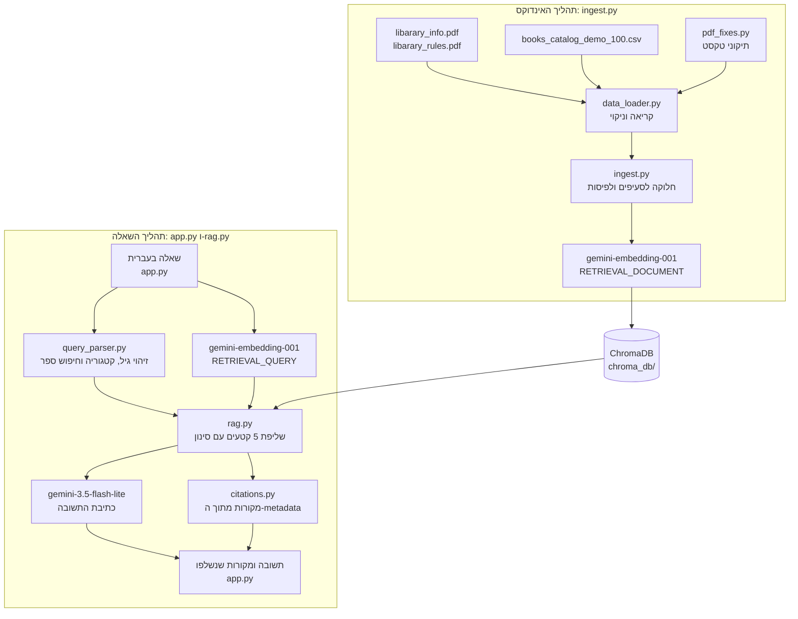

# ארכיטקטורה: עוזר הספרייה החכם

## 1. סקירה ומטרה

עוזר הספרייה החכם הוא מערכת RAG (Retrieval-Augmented Generation) בעברית. המערכת עונה על שני סוגי שאלות דרך אותו מסך ואותו מאגר:

1. מידע על הספרייה: שעות פתיחה, שירותים, הרשמה, השאלה, הארכה ואיחורים.
2. חיפוש והמלצה על ספרים מתוך קטלוג של 100 רשומות, לפי שם, קטגוריה, גיל ותקציר.

התשובה נכתבת על ידי Gemini, אך ורק מתוך קטעים שנשלפו מהמאגר. לצד כל תשובה מוצגים הקטעים שנשלפו.

## 2. תרשים המערכת

המקורות נבנים בנתיב נפרד מהמודל: הם יוצאים ישירות מתוצאות השליפה אל המסך, ולא מהטקסט ש-Gemini כתב.

## 3. תהליך האינדוקס

ההרצה: `python ingest.py`.

1. **קריאת PDF:** `pypdf` קורא כל עמוד בנפרד, כך שמספר העמוד נשמר.
2. **ניקוי:** נמחקים תפריטי אתר, פירורי לחם וסימנים מיוחדים. עמודים שלא נשאר בהם תוכן לא נכנסים למאגר.
3. **תיקון טקסט:** 24 שורות שבהן מספרים וטקסט לועזי זזו מוחלפות בנוסח הנכון.
4. **איחוד משפט:** משפט שנחתך בין עמודים עובר בשלמותו לעמוד שבו התחיל.
5. **קריאת CSV:** הקטלוג נקרא בקידוד `utf-8-sig`, וכל ספר הופך ל-Document אחד.
6. **חלוקה:** ה-PDF מחולק לסעיפים לפי כותרות, ואחר כך לפיסות. כל ספר נשאר פיסה אחת.
7. **Embeddings:** הטקסטים נשלחים ל-Gemini ב-20 טקסטים בכל פעם, בקצב של 80 בדקה, בגלל מכסה של 100 בדקה במסלול החינמי.
8. **שמירה:** הווקטורים, הטקסט וה-metadata נשמרים באוסף `library` ב-ChromaDB, עם מרחק קוסינוס.

**מניעת בנייה מיותרת:** הקוד מחשב טביעת אצבע של הטקסט, ה-metadata ושם המודל. אם היא זהה לשמורה ומספר הרשומות נכון, לא נשלח כלום ל-Gemini. בנייה חדשה מתחילה רק אחרי שכל ה-Embeddings התקבלו, כך שכישלון של Gemini לא מוחק מאגר קיים.

המאגר הנוכחי מכיל 131 פיסות: 31 מקובצי ה-PDF ו-100 ספרים.

## 4. תהליך השאלה

1. **קבלת שאלה:** `app.py` מקבל את השאלה ופותח את המאגר פעם אחת לכל בנייה.
2. **זיהוי דרישות:** `query_parser.py` בודק אם זה חיפוש בקטלוג, ומזהה גיל וקטגוריה. שאלה על כללי השאלה לא נחשבת חיפוש ספר, גם אם מופיעה בה המילה "ספר".
3. **שליפה:** השאלה הופכת ל-Embedding, ו-LlamaIndex שולף מ-ChromaDB עד 5 קטעים דומים. בחיפוש ספר חלים תנאים מדויקים על סוג המסמך, על הקטגוריה ועל טווח הגיל.
4. **אין תוצאות:** אם הסינון לא מצא ספר, הקוד מחזיר הודעה קבועה עם טווחי הגיל בקטלוג, בלי לשלוח כלום למודל התשובות.
5. **כתיבת תשובה:** Gemini מקבל הוראות קבועות, את הקטעים ואת השאלה.
6. **סירוב:** אם המודל מחזיר את משפט "לא נמצא מידע", לא מוצגים מקורות.
7. **תוצאה:** התשובה מוצגת יחד עם המקורות שנבנו מהשליפה.

בניתוק רשת הקוד מנסה עד 3 פעמים, עם המתנה של 2 שניות. תקלות אחרות לא מנוסות שוב.

## 5. אחריות הרכיבים

| קובץ | אחריות |
|---|---|
| `config.py` | נתיבים, מודלים, גודל פיסה וערכי ברירת מחדל |
| `pdf_fixes.py` | תיקוני הטקסט והשורות שנמחקות |
| `data_loader.py` | קריאת ה-PDF וה-CSV ויצירת Documents |
| `ingest.py` | חלוקה, Embeddings, שמירה וזיהוי מאגר מעודכן |
| `query_parser.py` | זיהוי חיפוש ספר, גיל וקטגוריה, ובניית הסינון |
| `rag.py` | פתיחת המאגר, שליפה, כתיבת תשובה וניסיונות חוזרים |
| `citations.py` | בניית המקורות מה-metadata |
| `app.py` | המסך בעברית והודעות השגיאה |
| `tests/` | בדיקות אוטומטיות, סקריפטי הערכה ותיעוד התוצאות |

## 6. זרימת הנתונים

| מ | אל | מה עובר |
|---|---|---|
| קובצי המקור | `data_loader.py` | טקסט לפי עמוד ורשומות קטלוג |
| `pdf_fixes.py` | `data_loader.py` | רשימת תיקונים ושורות למחיקה |
| `data_loader.py` | `ingest.py` | Documents עם metadata |
| `ingest.py` | Gemini Embeddings | טקסט הפיסות בלבד |
| `ingest.py` | ChromaDB | מזהה, טקסט, metadata ווקטור |
| `app.py` | `rag.py` | השאלה |
| `query_parser.py` | `rag.py` | תנאי סינון |
| `rag.py` | Gemini Embeddings | השאלה |
| ChromaDB | `rag.py` | קטעים, metadata וציוני דמיון |
| `rag.py` | Gemini LLM | הוראות, טקסט הקטעים והשאלה |
| `citations.py` | `app.py` | מקורות מסודרים |

## 7. בחירות טכנולוגיות

| טכנולוגיה | למה נבחרה |
|---|---|
| **Python** | שפת העבודה הנפוצה בתחום, עם תמיכה ישירה בכל הספריות האחרות. הפרויקט רץ על 3.12 |
| **LlamaIndex** | מספק את Document, Node, החלוקה, ה-Retriever והחיבור ל-Chroma, כך שהקוד מתמקד בלוגיקה של הפרויקט |
| **Gemini** | מספק מודל תשובות ומודל Embeddings באותו API ובאותו מפתח, ומטפל בעברית. המודלים נבדקו בפועל על המפתח של הפרויקט |
| **ChromaDB** | מאגר וקטורים מקומי, שנשמר בדיסק ולא דורש שרת. הוא תומך בסינון לפי metadata, וזה חיוני לגיל ולקטגוריה |
| **Streamlit** | ממשק אינטראקטיבי מ-Python בלבד. מתאים לפרויקט בלי הרשאות ובלי שרת נפרד |
| **pypdf** | קורא טקסט לפי עמוד. בהשוואה ל-PyMuPDF שני הכלים הזיזו מספרים, ו-pypdf השאיר את הפיסוק במקום |

## 8. טיפול במקורות PDF ו-CSV

**PDF:** הקבצים הם עמודי אתר שהודפסו, ולכן הם כוללים תפריטים, ובטקסט העברי מספרים זזים. הטיפול נעשה רק על הטקסט שנקרא, והקבצים המקוריים לא משתנים. אם תיקון כבר לא מתאים לקובץ, הקוד נעצר עם שגיאה, כדי שקובץ שהתחלף לא ייקרא עם טעויות בלי שישימו לב.

**CSV:** כל ספר הופך ליחידה אחת, ולכן מידע של ספרים שונים לא מתערבב. בקובץ כל הרשומות מסומנות כנתוני הדגמה סינתטיים שלא אומתה שייכותם לספרייה אמיתית. הסימון נשמר ב-metadata, והמסך מציג הערה קבועה שהקטלוג לא מאמת זמינות. כך לא צריך לחזור על ההערה בכל המלצה.

## 9. חלוקה ו-metadata

**PDF:** חלוקה לפי כותרות, למשל "ג. שאילת ספרים", ואחר כך `SentenceSplitter` עם 350 טוקנים ו-60 טוקנים של חפיפה. הכותרת נכתבת בתחילת כל פיסה. תת-כותרת מתחברת לראשית, למשל "ז. איחור בהחזרת ספר מושאל - איחור שני".

החלוקה לסעיפים החליפה חלוקה קודמת לפי עמודים, שהפרידה כותרות מהכללים שלהן וגרמה לתשובות חסרות.

| מקור | שדות metadata |
|---|---|
| PDF | `source_file`, `doc_type`, `page`, `section` |
| ספר | `source_file`, `doc_type`, `book_id`, `title`, `author`, `category`, `age_range`, `age_min`, `age_max`, `year`, `data_status`, `library_affiliation` |

ה-metadata לא נכלל בטקסט שנשלח ל-Embedding או למודל התשובות. הגיל נשמר גם כמספרים, כדי שאפשר יהיה לסנן לפיו בתנאי מדויק.

## 10. אסטרטגיית המקורות

המקורות נבנים ב-`citations.py` מהקטעים שהחיפוש החזיר, ו-Gemini לא משתתף בכך, ולכן הוא לא יכול להמציא מקור.

- **PDF:** שם הקובץ, מספר העמוד, הסעיף והקטע.
- **ספר:** שם הספר, המזהה, המחבר, הקטגוריה, הגיל, השנה והתקציר.

במסך הכותרת היא "מקורות שנשלפו", ולא "המקורות של התשובה", כי המערכת לא יודעת באילו קטעים המודל השתמש בפועל. ציון הדמיון מוצג, עם הסבר שהוא לא מבטיח שהמידע נכון.

## 11. מגבלות ופשרות

**מגבלות שנצפו בבדיקות:**

- **מסקנות:** שאלות עקיפות הן הסוג הפחות אמין. "אפשר לבוא עם תינוקים לשם?" קיבלה "כן" ב-2 מתוך 3 הרצות וסירוב באחת.
- **מסקנה שנראית כעובדה:** התשובות לא מסבירות איך הגיעו למסקנה, לפי בקשה מפורשת של המשתמשת. התשובה קצרה יותר, והבדיקה נעשית מול המקורות המוצגים.
- **ניסוח משתנה:** אותה שאלה יכולה לקבל ניסוח אחר בכל הרצה, ולפעמים יש משפט מיותר או שגיאת כתיב של המודל.
- **גיל במילים:** רק "בן 9" מזוהה, ו"בן תשע" לא. במקרה כזה הגיל לא נאכף.
- **הבנת שאלה לפי תבניות:** הזיהוי ב-`query_parser.py` מבוסס על מילים קבועות, ועלול לטעות בניסוחים שלא נבדקו.
- **ציוני דמיון צפופים:** שאלה לא קשורה קיבלה 0.721 ושאלה קשורה 0.773. לכן אין סף ציון, וההחלטה על סירוב נשארת למודל.
- **המלצות דומות:** תקצירי הקטלוג כמעט זהים, ולכן גם ההסברים דומים.
- **תיקוני PDF ספציפיים:** הם מתאימים לשני הקבצים הנוכחיים בלבד.
- **ניסיון חוזר ברשת:** נבדק בהדמיה בלבד, לא על ניתוק אמיתי.

**פשרות שנבחרו:**

| בחירה | היתרון | המחיר |
|---|---|---|
| תיקון ידני של שורות PDF | דיוק בנתונים כמו שעות ומספרי ימים | לא עובד אוטומטית על קבצים אחרים |
| 5 קטעים בכל שאלה | פחות טקסט למודל | קטע רלוונטי עלול להישאר בחוץ |
| היתר להסיק מסקנה פשוטה | תשובות ישירות לשאלות עקיפות | סיכון למסקנה לא מדויקת |
| מסלול חינמי של Gemini | ללא עלות | 100 טקסטים לדקה ו-1,000 ביום ב-Embeddings. בנייה לוקחת כדקה וחצי ומנצלת 131 מהמכסה, וכשהמכסה היומית נגמרת המערכת לא עונה |
| קטלוג הדגמה | נתונים מובנים ואחידים | הקטלוג לא מייצג את הספרים שבספרייה בפועל |
